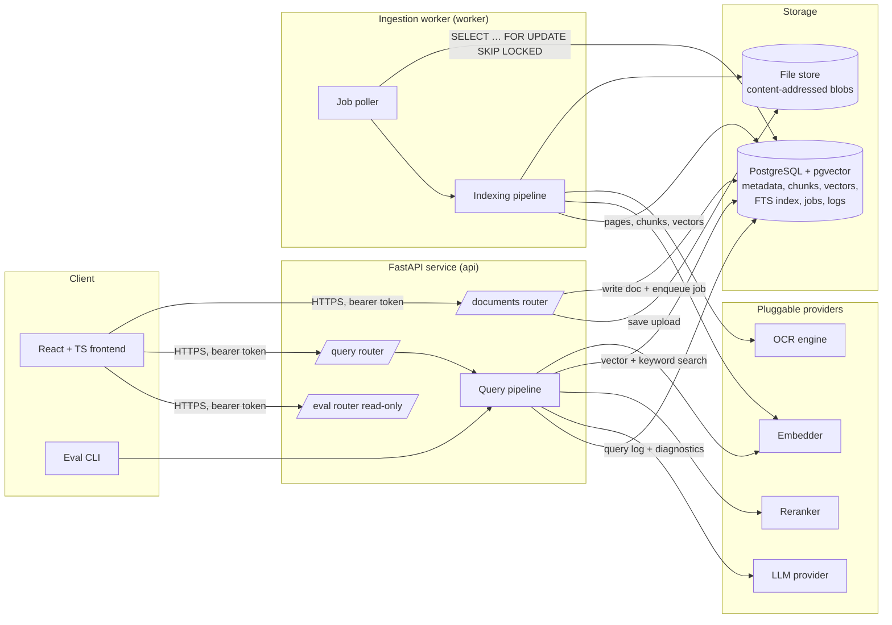
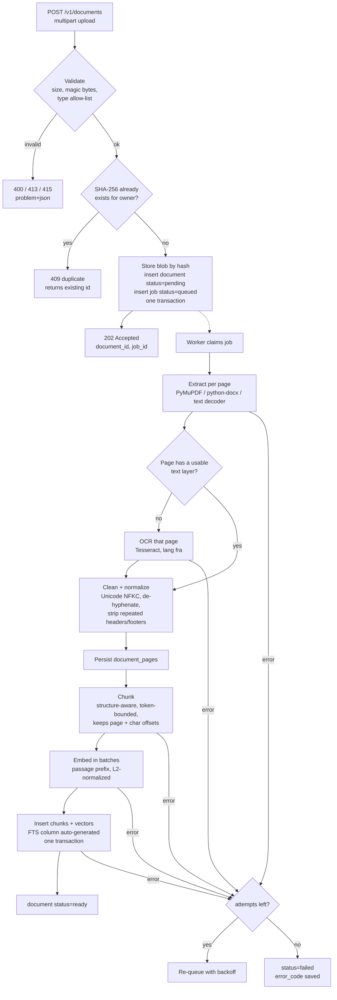
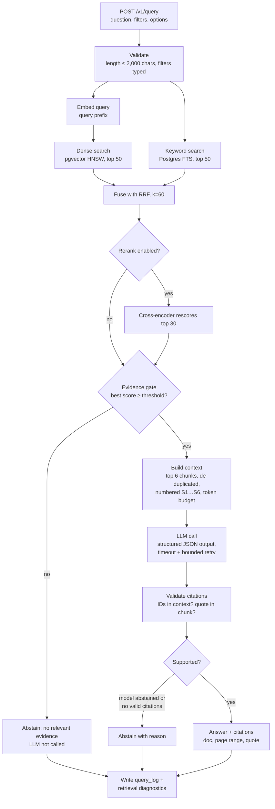

# DocuMind AI — Architecture (Phase 1)

> Status: **Reviewed, rev. 2.** The §13 decisions are made: **French first** (English is a post-v1
> optimization), **Groq** as the LLM provider, and a local **NVIDIA GTX 1660 Super (6 GB)** for embedding and
> reranking. No application code exists yet. Phase 2 starts from this document.

This document has two jobs:

1. Be the **design spec** for the system: components, pipelines, schema, API contracts, defaults, plan.
2. Be a **RAG study guide**. Each design decision includes a short *"RAG concept"* box that explains the idea
   behind it and the tradeoff it makes. The goal is that you could defend every choice in an interview.

---

## Table of contents

1. [Goals, non-goals, quality bar](#1-goals-non-goals-quality-bar)
2. [RAG in one page](#2-rag-in-one-page)
3. [System overview](#3-system-overview)
4. [Indexing pipeline](#4-indexing-pipeline)
5. [Query pipeline](#5-query-pipeline)
6. [Module boundaries and interfaces](#6-module-boundaries-and-interfaces)
7. [Directory layout](#7-directory-layout)
8. [Data model (PostgreSQL + pgvector)](#8-data-model-postgresql--pgvector)
9. [API contracts](#9-api-contracts)
10. [Evaluation design](#10-evaluation-design)
11. [Observability, security, reliability](#11-observability-security-reliability)
12. [Defaults chosen and why](#12-defaults-chosen-and-why)
13. [Review decisions](#13-review-decisions)
14. [Phase plan and acceptance criteria](#14-phase-plan-and-acceptance-criteria)
15. [Glossary](#15-glossary)

---

## 1. Goals, non-goals, quality bar

**Goal.** Users upload PDF, DOCX and TXT files (including scanned PDFs), ask questions in natural language,
and get answers that are grounded in their documents, with citations they can check (document, page, quoted
passage). When the documents don't contain the answer, the system says so instead of guessing.

**Quality bar (what makes this "production-style", not a toy):**

| Property | What it means here |
|---|---|
| Grounded | Every factual claim in an answer cites a chunk that was actually given to the model, and the cited quote really appears in that chunk. |
| Honest | The system abstains when evidence is insufficient, and abstention quality is measured. |
| Measurable | Retrieval and answer quality are measured on a fixed benchmark. Every number is reproducible from a recorded config. No metric is invented or estimated by hand. |
| Modular | Embedder, LLM, retriever, reranker, OCR engine and chunker sit behind interfaces and are chosen by config. |
| Testable | Every pipeline stage can run with deterministic fakes (fake embedder, fake LLM), so the test suite needs no network and no GPU. |
| Safe | Uploads are untrusted input. Every query is scoped to its owner. Logs contain no document text or questions. |

**Non-goals (for now):** multi-tenant SaaS billing, horizontal scaling beyond one worker host, fine-tuning
models, agentic multi-step tool use, image or table understanding beyond the extracted text.

---

## 2. RAG in one page

An LLM only knows what it saw in training plus what you put in its prompt. **Retrieval-Augmented Generation**
puts the *relevant parts of your documents* into the prompt at question time, and instructs the model to
answer only from them.

There are two pipelines:

- **Indexing (offline, once per document):** turn documents into small, searchable units (*chunks*) and store
  them with two kinds of search keys: a dense **embedding vector** (meaning) and a sparse **keyword index**
  (exact words).
- **Querying (online, per question):** find the few chunks most likely to contain the answer, give them to the
  LLM with strict instructions, and check that the answer actually cites them.

Nearly every quality problem in RAG falls into one of three buckets, and the architecture keeps them
separately measurable:

| Failure | Symptom | Where we measure it |
|---|---|---|
| **Retrieval miss** | The answer is in the corpus, but the right chunk was not retrieved. | Recall@K, MRR, nDCG (§10) |
| **Generation error** | The right chunk was retrieved, but the model ignored it, misread it, or added facts. | Faithfulness, answer correctness, citation accuracy |
| **Calibration error** | The model answered when it should have abstained, or the reverse. | Abstention precision and recall |

> **Key idea:** you cannot fix generation by tuning retrieval, or the reverse. That is why we evaluate the two
> stages separately and save the intermediate results (the retrieved chunks) for every query.

---

## 3. System overview



**Deployable units (Docker Compose services):**

| Service | Role |
|---|---|
| `db` | PostgreSQL 17 with the pgvector extension (`pgvector/pgvector:pg17` image). |
| `api` | FastAPI: upload, document management, query, eval results. Stateless. |
| `worker` | Same Python package, different entrypoint: polls the job table and runs the indexing pipeline. |
| `frontend` | React + TS, built by Vite and served by nginx (Phase 5). |

**GPU placement.** The LLM runs remotely (Groq), so the local GPU (GTX 1660 Super, 6 GB, CUDA compute
capability 7.5) is used only for the **embedder and reranker**. In fp16 these need roughly 1.2 GB each, so both
fit with room to spare. The device is chosen by config (`MODEL_DEVICE=auto|cuda|cpu`), and everything also runs
on CPU, which is what tests and CI use. **Phases 2–4 run `api` and `worker` natively on Windows** (a `uv`
virtualenv with CUDA-enabled PyTorch) with only `db` in Docker. That's the simplest way to use the GPU. GPU
access *inside* containers (Docker Desktop's WSL2 backend + NVIDIA driver, compose `gpus:` reservation) comes
in Phase 5 as an optional compose profile.

**Why a separate worker and not FastAPI `BackgroundTasks`?** OCR and embedding can take minutes for a large
scanned PDF. Running them inside the API process ties up its workers, the work is lost if the process restarts,
and it can't be retried. A worker process with a **durable job table** fixes all three.

**Why a Postgres job table and not Celery + Redis?** One fewer piece of infrastructure, jobs live in the same
transaction as the document row (no "row committed, enqueue failed" inconsistency), and
`SELECT … FOR UPDATE SKIP LOCKED` is a well-known, correct way to build a queue. If you ever need high
throughput, the `JobQueue` interface lets you swap in another queue.

---

## 4. Indexing pipeline



### 4.1 Validation (untrusted input)

- **Type by content, not by name.** Check the magic bytes (`%PDF-`, the ZIP header plus
  `word/document.xml` for DOCX, valid UTF-8 or a detected encoding for TXT). The extension and the client's
  `Content-Type` are hints only.
- **Limits** (configurable): 50 MB per file, 1,000 pages, 2 MB of text per TXT page-equivalent.
- **DOCX zip-bomb guard:** reject if the total uncompressed size is more than 200 MB or more than 100× the
  compressed size.
- **PDF:** reject encrypted PDFs (`needs_pass`) with a clear error code. Never execute embedded JavaScript
  (PyMuPDF doesn't, but we also never render attachments).
- **Filename** is stored for display only. Blobs are stored as `<sha256>` under the storage root, so a
  user-controlled path is never touched (no path traversal).

### 4.2 Extraction and OCR

Each extractor returns a list of `PageText(page_number, text, method, ocr_confidence)`. DOCX has no real
pages, so we create **logical pages** by splitting at explicit page breaks, or failing that every ~3,000
characters. The citation then says "section 4", not a printed page number. That limitation is documented.

**OCR decision is per page, not per document.** Many "scanned" PDFs mix pages with a text layer and pages
without one. Rule: if a page's text layer has fewer than `OCR_MIN_CHARS` (default 25) non-whitespace
characters *and* the page contains an image, rasterize it at 300 DPI and OCR it. Each page records its
`extraction_method` (`text_layer` | `ocr` | `docx` | `plain`) and OCR confidence, so we can later ask
"do OCR'd pages retrieve worse?", which is a good eval slice.

OCR language is `fra` by default (Tesseract's French model; `fra+eng` when English support arrives). Without the
right language pack, Tesseract misreads accented characters (`é` → `e'`, `à` → `a`), and every misread word is
a missed keyword match.

**Document language** is detected at ingestion (`lingua-language-detector` on the extracted text) and stored on
the document. In v1, anything that isn't French is still indexed but flagged, because its stemming and
answer quality aren't tuned yet.

> **RAG concept: garbage in, garbage out.** Retrieval can't find what extraction mangled. Typical PDF problems
> are hyphenation across lines ("informa-\ntion"), running headers and footers repeated on every page (they
> pollute every chunk and inflate keyword matches), ligatures (`fi`), and multi-column layouts read in the
> wrong order. The cleaning step fixes the cheap ones. Layout-aware parsing is a later improvement, not
> Phase 2.

### 4.3 Chunking

**Default:** *structure-aware recursive splitting, bounded by tokens.*

- Split on the strongest boundary first: headings → blank lines (paragraphs) → sentences → words, until each
  piece is ≤ `CHUNK_MAX_TOKENS` (default **350**). Then merge neighbors up to that bound.
- **Overlap** of `CHUNK_OVERLAP_TOKENS` (default **50**, about 15%) between consecutive chunks.
- **Tokens are counted with the embedding model's own tokenizer.** That tokenizer is what silently truncates
  input, so counting with any other tokenizer risks embedding only part of a chunk. It also matters for
  French: a multilingual tokenizer (XLM-RoBERTa, used by bge-m3) splits French text into more tokens per word
  than an English tokenizer would, so "350 tokens" is less French text than you might expect.
- **Sentence splitting is French-aware**, so abbreviations such as "M.", "art.", "p. ex." or "cf." don't end
  a sentence. *(Changed in Phase 2: a small regex splitter with a French abbreviation list replaces `pysbd`.
  It returns exact character spans, which the offset-based citations need, and its behavior is pinned by
  unit tests.)*
- **Overlap is sentence-level:** the next chunk starts a few whole sentences back. If the last sentence is
  bigger than the overlap budget, two chunks don't overlap, because overlap never cuts a sentence.
- Every chunk keeps `page_start`, `page_end`, `char_start`, `char_end` (offsets into the concatenated
  document text) and the nearest heading (`section_path`). Chunks may cross a page boundary; the citation then
  shows a page range ("pp. 4–5").
- Chunk IDs are **deterministic**: `uuid5(document_id, chunker_config_hash, chunk_index)`. Re-indexing with
  the same config produces the same IDs, which keeps logs, eval results and citations stable.

> **RAG concept: the chunk-size tradeoff.**
> - **Too small** (e.g. 64 tokens): precise vectors, but a chunk loses the context needed to answer ("it
>   increased by 4%": what did?). More chunks also means more of them are needed to cover one answer.
> - **Too large** (e.g. 1,500 tokens): the vector becomes an average of several topics, so it matches nothing
>   strongly (a *diluted* embedding). Each retrieved chunk also uses more of the LLM's context budget, so fewer
>   distinct sources fit.
> - **Overlap** protects facts that straddle a boundary, at the cost of some duplicate storage and duplicate
>   hits (we de-duplicate overlapping hits before building the context).
> - 300–500 tokens is a common, well-supported starting range, but the right value depends on the corpus. The
>   chunker is an interface and its config is recorded, so in Phase 4 we can **measure** 250 vs 350 vs 600
>   instead of guessing.

Alternatives we keep in mind for later: *semantic chunking* (split where consecutive sentence embeddings
diverge), *parent-child / small-to-big* (retrieve small chunks, send their parent section to the LLM), and
*contextual chunk headers* (prefix each chunk with document title + section before embedding).

### 4.4 Embedding

- **Default model:** `BAAI/bge-m3` via Sentence Transformers, dense output, **1024 dimensions** (~568M
  parameters). It's one of the strongest open multilingual retrievers, it's good on French, and it handles
  long inputs (up to 8,192 tokens). On the 1660 Super in fp16 it embeds a few hundred chunks per minute. On CPU,
  query-time embedding still takes only a fraction of a second, but bulk indexing is slow, which is why
  indexing uses the GPU.
- **Why not an English model with a French fallback?** Embedding models only place texts well in the
  languages they were trained on. An English-only model maps French text to poorly organized regions of the
  vector space, and retrieval quality collapses. Multilingual models also give *cross-lingual* retrieval: a
  French question can match an English passage. That will matter when English documents are added later.
- **Asymmetric encoding:** many models expect a different prefix for queries and passages (E5 uses
  `query:` / `passage:`; English BGE models use a query instruction). bge-m3 needs **no** prefix for dense
  retrieval, but the `Embedder` interface still has two methods, `embed_documents()` and `embed_query()`, so
  swapping in a model that *does* need prefixes can't silently break retrieval. Mixing them up is a classic
  silent bug that costs several points of recall.
- *Learning note:* bge-m3 can also produce **sparse lexical weights** (a learned, BM25-like signal) from the
  same forward pass. That's a candidate replacement for Postgres FTS as the "keyword" side of hybrid search,
  to be tested in Phase 4.
- Vectors are **L2-normalized**, so cosine similarity equals the dot product, and we use pgvector's cosine
  distance operator `<=>`.
- Every chunk records `embedding_model`. The query path refuses to search chunks embedded by a different model
  (comparing vectors from two models is meaningless).

> **RAG concept: bi-encoders.** The embedder encodes the query and each passage *independently* into vectors,
> so passages can be encoded once at index time and searched in milliseconds with an approximate
> nearest-neighbor (ANN) index. The price is that the query and passage never "see" each other, which limits
> precision. Reranking (§5.4) pays that price back.

### 4.5 Storage and deletion

Pages, chunks and vectors are written in **one transaction** per document. The `tsvector` column for keyword
search is a *generated column*, so it can never get out of sync with the text.

**Deletion** (`DELETE /v1/documents/{id}`): set `status = deleting` (the document disappears from retrieval
immediately, because queries filter on `status = 'ready'`), enqueue a `delete` job, and the worker deletes the
rows (chunks and pages go via `ON DELETE CASCADE`) and then the blob if no other document references the
same hash. This makes "deleted documents are never cited" a testable guarantee.

---

## 5. Query pipeline



All filters (`owner_id`, `status = 'ready'`, optional `document_ids`, `mime_types`, date range) are applied
**inside** both SQL searches, never after them, so another user's chunk can never enter a candidate list.

### 5.1 Dense retrieval

```sql
SELECT c.id, 1 - (c.embedding <=> :qvec) AS score
FROM chunks c JOIN documents d ON d.id = c.document_id
WHERE c.owner_id = :owner AND d.status = 'ready' AND c.embedding_model = :model
  -- optional: AND c.document_id = ANY(:doc_ids)
ORDER BY c.embedding <=> :qvec
LIMIT :k;
```

> **RAG concept: ANN plus filters.** HNSW is an *approximate* index. It walks a graph and returns about
> `ef_search` candidates, and the `WHERE` clause is applied to those candidates afterwards. With a selective
> filter (one user's 3 documents out of 100,000 chunks) you can get **fewer than k results**. pgvector ≥ 0.8
> solves this with *iterative index scans* (`SET hnsw.iterative_scan = relaxed_order`), which we enable. At
> portfolio scale an exact scan would also work, but we want to understand the real behavior.

### 5.2 Keyword retrieval

Postgres full-text search: `websearch_to_tsquery(:fts_config, :q)` against a GIN-indexed `tsvector`, ranked
by `ts_rank_cd`. In v1, `:fts_config` is **`documind_fr`**, a custom text-search configuration defined in the
migration:

```sql
CREATE EXTENSION IF NOT EXISTS unaccent;
CREATE TEXT SEARCH CONFIGURATION documind_fr (COPY = french);
ALTER TEXT SEARCH CONFIGURATION documind_fr
    ALTER MAPPING FOR hword, hword_part, word WITH unaccent, french_stem;
```

> **RAG concept: stemming and accents in French.** Keyword search matches *normalized tokens*, not raw words.
> The French Snowball stemmer reduces "résiliation", "résilier" and "résilié" to a shared stem, so
> morphological variants match. Adding `unaccent` *before* stemming makes `resiliation` (typed without accents,
> very common in queries) match `résiliation`, and it absorbs OCR accent errors. The cost is a few false
> merges (`pêche` vs `péché`), which is acceptable for recall-oriented first-stage retrieval. Stop words ("le",
> "de", "et") are dropped by the `french` config.
>
> The FTS config is stored **per chunk** (`chunks.fts_config`, §8), so adding English later only adds a second
> config; the French chunks are never touched.

> **RAG concept: why dense alone is not enough.** Embeddings capture *meaning*. They are good at paraphrase
> ("cancel my subscription" ≈ "terminate the agreement") but weak at **exact tokens**: product codes
> (`XK-4471`), error numbers, names, clause numbers, rare jargon. They map those to "something
> similar-looking". Keyword search is the opposite: exact and literal, blind to synonyms. Their failures are
> largely *uncorrelated*, which is exactly when combining two systems pays off.
>
> **Honesty note:** `ts_rank_cd` is not BM25. It doesn't saturate term frequency or normalize by document
> length the way BM25 does. That's acceptable because RRF only uses **ranks**, not scores. If keyword quality
> turns out to be the bottleneck, the `KeywordRetriever` interface allows a real BM25 implementation
> (e.g. the ParadeDB `pg_search` extension) without touching anything else. We'll let the benchmark decide.

### 5.3 Hybrid fusion: Reciprocal Rank Fusion (RRF)

```
RRF(chunk) = Σ over retrievers r of   1 / (k + rank_r(chunk))       k = 60, ranks start at 1
```

A chunk ranked 1st by dense and 3rd by keyword gets 1/61 + 1/63 ≈ 0.0323. A chunk ranked 1st by only one
retriever gets 1/61 ≈ 0.0164. Agreement wins.

> **RAG concept: why fuse ranks instead of scores.** A cosine similarity of 0.82 and a `ts_rank_cd` of 0.1 are
> on unrelated scales, and their distributions shift with each query. A weighted sum of raw scores needs
> per-query normalization and tuning, and it breaks quietly. RRF ignores scores, needs no training, and has a
> single, insensitive parameter (`k`). A larger `k` flattens the curve, so lower-ranked items keep more
> influence. The tradeoff is that RRF throws away information about *how much* better the top hit was. A
> learned or weighted fusion could beat it with tuning, and our eval harness can test that later.

### 5.4 Reranking (optional, config `RERANK_ENABLED`)

Default model: `BAAI/bge-reranker-v2-m3` (multilingual cross-encoder, same family as the embedder, good on
French). It rescores the top 30 fused candidates as `(question, chunk)` pairs, then we keep the top 6. It runs
on the GPU. The CPU fallback is the smaller multilingual
`cross-encoder/mmarco-mMiniLMv2-L12-H384-v1`, because the large model is too slow per query on CPU.

> **RAG concept: bi-encoder vs cross-encoder.** A cross-encoder reads the question and the passage
> **together** through every layer, so it can judge "does this passage answer *this* question?" much more
> precisely than comparing two independent vectors. It can't be precomputed, though: every query costs one
> forward pass per candidate (30 pairs is well under a second on the GPU and several seconds on CPU for a model
> this size; we will measure both). So the standard design is a **cascade**: a
> cheap, high-recall stage (hybrid, top 50) followed by an expensive, high-precision stage (rerank, top 6).
> Reranking is **off by default until Phase 4 shows it helps on our data.** We'll have a measured latency
> versus nDCG tradeoff to point to.

### 5.5 Context building

- Take the top `CONTEXT_MAX_CHUNKS` (default 6) within a `CONTEXT_MAX_TOKENS` budget (default 3,000).
- **De-duplicate** overlapping neighbors (adjacent chunk indices from the same document whose overlap region
  is shared) by merging them into one source.
- Order: by relevance, but put the strongest source first *and* last if there are many, to counter the
  "lost in the middle" effect, where models attend less to the middle of long contexts.
- Each source is wrapped and labelled:

```
<source id="S1" document="contrat.pdf" pages="4-5">
...texte du chunk...
</source>
```

- Document text is placed inside clearly delimited data tags. The system prompt states that text inside
  `<source>` is **untrusted data, never instructions** (prompt-injection defense, §11).

### 5.6 Generation with structured output

**Provider: Groq**, through the OpenAI-compatible endpoint (`https://api.groq.com/openai/v1`). We implement
**one** `OpenAICompatLLM` class. Groq is just a `base_url` + `GROQ_API_KEY` + model ID in config, and the same
class works later with OpenAI, Ollama or vLLM. The API key lives only in `.env` (git-ignored). Never paste it in
chat or commit it.

**Default generator model: `openai/gpt-oss-120b`.** It's a Groq *production* model (131k context), and it
supports **strict `json_schema` structured outputs**, meaning Groq constrains decoding so the response always
matches our schema. That removes a whole class of parse failures. `llama-3.3-70b-versatile` is the
alternative. It only supports JSON-object mode (valid JSON, schema not enforced), so it goes through our
Pydantic validation plus the repair retry. Model IDs are config, and Phase 2 checks them against Groq's
`GET /models` at startup, because providers retire models.

> Groq caveats that shape the design: structured outputs **can't be combined with streaming** (so
> `/v1/query/stream` streams only after validation, or isn't offered for structured answers), and in strict
> mode every field must be `required`, with optional values expressed as nullable types. Our schema is
> written that way.

The LLM must return JSON validated by a Pydantic model:

```json
{
  "answer": "Le préavis de résiliation est de 30 jours [S2].",
  "citations": [{"source_id": "S2", "quote": "chacune des parties peut résilier le contrat moyennant un préavis de trente (30) jours"}],
  "insufficient_evidence": false,
  "reason": null
}
```

Prompt rules (the system prompt is **written in French**, which gives more natural French answers than
English instructions do): answer only from the sources; **answer in the language of the question** (French in
v1); cite every claim with `[S#]`; each citation includes a short **verbatim** quote copied from the source,
never translated; if the sources don't contain the answer, set `insufficient_evidence: true` and give no
answer. On a JSON or validation failure we retry **once** with the validation error included. On a second
failure we return a 502-class error, not malformed output.

### 5.7 Citation validation (post-generation guardrail)

For each citation:

1. `source_id` must be one of the sources in the context. Otherwise it's a **fabricated citation**: dropped,
   and counted in metrics.
2. `quote` must appear in that chunk's text, after whitespace and Unicode normalization. We allow a fuzzy
   match (`rapidfuzz.partial_ratio ≥ 90`) to tolerate small OCR or quoting differences. Otherwise it's an
   **unsupported quote**: dropped and counted.
3. Each `[S#]` marker in the answer must have a surviving citation.

`S#` is mapped back to `chunk_id → document_id, page_start, page_end`. **Those IDs travel end to end**: from
the chunks table through retrieval, context and validation to the API response and the query log.

### 5.8 Abstention: three gates

| Gate | When | Signal | Cost |
|---|---|---|---|
| 1. Retrieval evidence gate | Before the LLM | Best reranker score (or best dense similarity if rerank is off) below a threshold | Saves an LLM call |
| 2. Model self-report | During generation | `insufficient_evidence: true` | — |
| 3. Citation gate | After generation | No citation survives validation | Catches "confident but ungrounded" answers |

> **RAG concept: abstention is a precision/recall tradeoff.** A strict threshold refuses answerable questions
> (annoying); a loose one answers unanswerable questions (dangerous: these are hallucinations by
> construction). There is no universally correct threshold. Scores depend on the model and the corpus. So the
> Gate-1 threshold is **calibrated in Phase 4** on the benchmark's answerable and unanswerable questions, and
> we report the curve, not one hand-picked number. Until then Gate 1 is permissive (low threshold) and Gates 2
> and 3 do the work.

---

## 6. Module boundaries and interfaces

The rule: **modules depend on interfaces, never on each other's implementations.** The composition root
(`documind/container.py`) reads config and wires concrete classes. Tests wire fakes.

```python
# Sketch only; the real signatures land in Phase 2.
class Embedder(Protocol):
    model_id: str
    dim: int
    def embed_documents(self, texts: Sequence[str]) -> np.ndarray: ...   # (n, dim), L2-normalized
    def embed_query(self, text: str) -> np.ndarray: ...                  # (dim,)

class Retriever(Protocol):
    name: str                                                            # "dense" | "keyword" | "hybrid"
    def retrieve(self, query: Query, filters: SearchFilters, k: int) -> list[ScoredChunk]: ...

class Reranker(Protocol):
    model_id: str
    def rerank(self, query: str, chunks: list[ScoredChunk], top_n: int) -> list[ScoredChunk]: ...

class LLMProvider(Protocol):
    model_id: str
    def generate(self, messages: list[Message], *, schema: type[BaseModel],
                 max_tokens: int, timeout_s: float) -> LLMResult: ...      # parsed + usage + latency

class OCREngine(Protocol):
    name: str
    def ocr_page(self, image: bytes, lang: str) -> OCRResult: ...           # text + mean confidence

class Extractor(Protocol):
    def supports(self, mime: str) -> bool: ...
    def extract(self, path: Path) -> list[PageText]: ...

class Chunker(Protocol):
    config_hash: str
    def chunk(self, pages: list[PageText]) -> list[ChunkDraft]: ...
```

| Module | Owns | Must not know about |
|---|---|---|
| `ingestion` | validation, storage, extraction, OCR, cleaning, job orchestration | HTTP, LLMs |
| `chunking` | splitting text into `ChunkDraft`s with offsets | embeddings, DB |
| `embedding` | text → vectors | DB, chunking |
| `indexing` | pages → chunks → vectors → DB | HTTP |
| `retrieval` | search, fusion, filters, rerank | LLMs, HTTP |
| `generation` | prompts, context, LLM calls, citation validation, abstention | SQL, HTTP |
| `rag` | the query pipeline (wires retrieval + generation) | HTTP |
| `evaluation` | datasets, metrics, runners, reports | HTTP (calls `rag` directly) |
| `api` | HTTP, auth, request/response schemas | SQL details, model details |
| `db` | tables, sessions, repositories (all SQL lives here) | business logic |

**Fakes for tests** (all deterministic): `HashEmbedder` (hashes tokens into a fixed vector, so similar texts
share dimensions), `ScriptedLLM` (returns canned JSON, or echoes the first source), `NoopReranker`,
`FixtureOCR`.

---

## 7. Directory layout

```
RAG/
├── README.md
├── docker-compose.yml
├── .env.example                      # every setting, documented; no secrets
├── docs/
│   ├── architecture.md               # this file
│   ├── adr/                          # one short Architecture Decision Record per major choice
│   └── runbook.md                    # Phase 6
├── backend/
│   ├── pyproject.toml                # uv-managed; ruff, mypy, pytest config
│   ├── uv.lock
│   ├── Dockerfile
│   ├── alembic.ini
│   ├── migrations/                   # Alembic versions (schema in §8)
│   ├── src/documind/
│   │   ├── config.py                 # pydantic-settings; single source of config
│   │   ├── container.py              # composition root: config → concrete implementations
│   │   ├── domain/                   # Pydantic domain models + error types (no I/O)
│   │   ├── db/                       # SQLAlchemy tables, session, repositories
│   │   ├── ingestion/
│   │   │   ├── validation.py
│   │   │   ├── storage.py            # BlobStore interface + LocalBlobStore
│   │   │   ├── extractors/           # pdf.py, docx.py, txt.py
│   │   │   ├── ocr/                  # base.py, tesseract.py, paddle.py (optional extra)
│   │   │   ├── cleaning.py
│   │   │   └── jobs.py               # JobQueue interface + Postgres implementation
│   │   ├── chunking/                 # base.py, recursive.py, tokenizer.py
│   │   ├── embedding/                # base.py, sentence_transformers.py, openai_compat.py, fake.py
│   │   ├── indexing/                 # service.py (pages → chunks → vectors → DB)
│   │   ├── retrieval/                # dense.py, keyword.py, fusion.py, hybrid.py, filters.py, rerank/
│   │   ├── generation/
│   │   │   ├── llm/                  # base.py, openai_compat.py (Groq), fake.py
│   │   │   ├── prompts/              # versioned prompt templates (prompt_version is logged)
│   │   │   ├── context.py
│   │   │   ├── citations.py
│   │   │   └── abstention.py
│   │   ├── rag/                      # query_pipeline.py
│   │   ├── evaluation/
│   │   │   ├── dataset.py            # schema + loader for benchmark JSONL
│   │   │   ├── metrics/              # retrieval.py, generation.py, abstention.py
│   │   │   ├── ragas_adapter.py
│   │   │   ├── runner.py
│   │   │   └── report.py             # markdown/JSON report from a run
│   │   ├── observability/            # logging.py (structured, redacting), timing.py
│   │   ├── worker/main.py            # `python -m documind.worker`
│   │   ├── cli.py                    # `documind eval run …`, `documind ingest …`
│   │   └── api/
│   │       ├── app.py
│   │       ├── deps.py               # auth, DB session, container
│   │       ├── errors.py             # problem+json mapping
│   │       ├── schemas.py            # request/response models (API contract)
│   │       └── routers/              # documents.py, query.py, jobs.py, eval.py, health.py
│   └── tests/
│       ├── unit/                     # pure functions: chunking, RRF, metrics, citation validation
│       ├── integration/              # real Postgres (compose `db`), fakes for models
│       ├── e2e/                      # upload → query over HTTP
│       └── fixtures/                 # tiny PDFs/DOCX/TXT, one scanned page, one malicious-ish file
├── frontend/                         # Vite + React + TS (Phase 5)
└── eval/
    ├── corpus/                       # benchmark documents (public-domain / licensed; see §10)
    ├── datasets/                     # *.jsonl Q&A sets, versioned
    └── results/                      # generated run reports (JSON + markdown), committed
```

**Why `src/` layout:** tests run against the *installed* package, which catches packaging mistakes, and
`backend/` vs `frontend/` keeps the two toolchains apart.

---

## 8. Data model (PostgreSQL + pgvector)

```sql
CREATE EXTENSION IF NOT EXISTS vector;          -- pgvector >= 0.8

-- ── Identity & access ─────────────────────────────────────────────
CREATE TABLE users (
    id          uuid PRIMARY KEY DEFAULT gen_random_uuid(),
    email       text NOT NULL UNIQUE,
    created_at  timestamptz NOT NULL DEFAULT now()
);

CREATE TABLE api_keys (
    id          uuid PRIMARY KEY DEFAULT gen_random_uuid(),
    user_id     uuid NOT NULL REFERENCES users(id) ON DELETE CASCADE,
    key_prefix  text NOT NULL,                    -- first 8 chars, for display/lookup
    key_hash    bytea NOT NULL UNIQUE,            -- SHA-256 of the full key; plaintext never stored
    created_at  timestamptz NOT NULL DEFAULT now(),
    revoked_at  timestamptz
);

-- ── Documents ────────────────────────────────────────────────────
CREATE TABLE documents (
    id             uuid PRIMARY KEY DEFAULT gen_random_uuid(),
    owner_id       uuid NOT NULL REFERENCES users(id) ON DELETE CASCADE,
    filename       text NOT NULL,                 -- display only, never used as a path
    mime_type      text NOT NULL CHECK (mime_type IN (
                     'application/pdf',
                     'application/vnd.openxmlformats-officedocument.wordprocessingml.document',
                     'text/plain')),
    size_bytes     bigint NOT NULL CHECK (size_bytes > 0),
    sha256         char(64) NOT NULL,
    storage_key    text NOT NULL,
    status         text NOT NULL DEFAULT 'pending'
                     CHECK (status IN ('pending','processing','ready','failed','deleting')),
    error_code     text,                          -- machine-readable, e.g. 'pdf_encrypted'
    page_count     int,
    ocr_page_count int NOT NULL DEFAULT 0,
    language       text NOT NULL DEFAULT 'fr',    -- detected at ingestion (ISO 639-1)
    title          text,
    metadata       jsonb NOT NULL DEFAULT '{}',   -- author, created date from file props, user tags
    created_at     timestamptz NOT NULL DEFAULT now(),
    updated_at     timestamptz NOT NULL DEFAULT now(),
    UNIQUE (owner_id, sha256)                     -- exact-duplicate detection per owner
);
CREATE INDEX documents_owner_status ON documents (owner_id, status);

-- Extracted text per (physical or logical) page. Kept so we can re-chunk
-- without re-running OCR, and to render the cited page in the UI.
CREATE TABLE document_pages (
    document_id        uuid NOT NULL REFERENCES documents(id) ON DELETE CASCADE,
    page_number        int  NOT NULL CHECK (page_number >= 1),
    text               text NOT NULL,
    extraction_method  text NOT NULL CHECK (extraction_method IN ('text_layer','ocr','docx','plain')),
    ocr_confidence     real,                      -- 0..100, NULL unless OCR
    char_offset        int  NOT NULL,             -- start of this page in the concatenated doc text
    PRIMARY KEY (document_id, page_number)
);

-- ── Chunks + vectors + keyword index ─────────────────────────────
CREATE TABLE chunks (
    id               uuid PRIMARY KEY,            -- uuid5(document_id, chunker_config_hash, chunk_index)
    document_id      uuid NOT NULL REFERENCES documents(id) ON DELETE CASCADE,
    owner_id         uuid NOT NULL,               -- denormalized: every search filters on it
    chunk_index      int  NOT NULL,
    page_start       int  NOT NULL,
    page_end         int  NOT NULL CHECK (page_end >= page_start),
    char_start       int  NOT NULL,
    char_end         int  NOT NULL CHECK (char_end > char_start),
    section_path     text,                        -- e.g. 'Terms > Termination'
    text             text NOT NULL,
    token_count      int  NOT NULL,
    chunker_config_hash text NOT NULL,
    embedding_model  text NOT NULL,
    embedding        vector(1024) NOT NULL,       -- bge-m3; dim fixed by the model, see note below
    fts_config       regconfig NOT NULL DEFAULT 'documind_fr',  -- per-chunk language config (§5.2)
    tsv              tsvector GENERATED ALWAYS AS (to_tsvector(fts_config, text)) STORED,
    created_at       timestamptz NOT NULL DEFAULT now(),
    UNIQUE (document_id, chunk_index)
);
CREATE INDEX chunks_embedding_hnsw ON chunks USING hnsw (embedding vector_cosine_ops)
    WITH (m = 16, ef_construction = 64);
CREATE INDEX chunks_tsv_gin        ON chunks USING gin (tsv);
CREATE INDEX chunks_owner_doc      ON chunks (owner_id, document_id);

-- ── Background jobs (durable queue) ──────────────────────────────
CREATE TABLE jobs (                              -- Phase 2: owner_id added; document_id nullable,
    id            uuid PRIMARY KEY DEFAULT gen_random_uuid(),   -- so a finished delete job stays pollable
    owner_id      uuid NOT NULL REFERENCES users(id) ON DELETE CASCADE,
    document_id   uuid REFERENCES documents(id) ON DELETE SET NULL,
    kind          text NOT NULL CHECK (kind IN ('ingest','reindex','delete')),
    status        text NOT NULL DEFAULT 'queued'
                    CHECK (status IN ('queued','running','succeeded','failed')),
    stage         text,                          -- validating|extracting|ocr|chunking|embedding|storing
    progress      real NOT NULL DEFAULT 0 CHECK (progress BETWEEN 0 AND 1),
    attempts      int  NOT NULL DEFAULT 0,
    max_attempts  int  NOT NULL DEFAULT 3,
    run_after     timestamptz NOT NULL DEFAULT now(),   -- exponential backoff on retry
    locked_by     text,
    locked_at     timestamptz,                   -- stale lock (> JOB_TIMEOUT) ⇒ reclaimable
    last_error    text,                          -- error code + safe message, no document text
    created_at    timestamptz NOT NULL DEFAULT now(),
    updated_at    timestamptz NOT NULL DEFAULT now()
);
CREATE INDEX jobs_claimable ON jobs (run_after) WHERE status = 'queued';

-- ── Query observability ──────────────────────────────────────────
CREATE TABLE query_logs (
    id               uuid PRIMARY KEY DEFAULT gen_random_uuid(),
    owner_id         uuid NOT NULL REFERENCES users(id) ON DELETE CASCADE,
    question         text NOT NULL,              -- user data; retention-limited; never in app logs
    config           jsonb NOT NULL,             -- retrieval mode, k values, models, prompt_version
    answer           jsonb,                      -- final response body
    abstained        boolean NOT NULL,
    abstention_gate  smallint,                   -- 1, 2, 3 or NULL
    latency_ms       jsonb NOT NULL,             -- {"embed":12,"dense":8,"keyword":5,"rerank":0,"llm":1840,"total":1890}
    input_tokens     int,
    output_tokens    int,
    cost_usd         numeric(10,6),              -- computed from configured prices; NULL if unknown
    citations_dropped int NOT NULL DEFAULT 0,
    error_code       text,
    created_at       timestamptz NOT NULL DEFAULT now()
);

CREATE TABLE query_retrievals (                  -- "why did it retrieve that?" diagnostics
    query_id   uuid NOT NULL REFERENCES query_logs(id) ON DELETE CASCADE,
    stage      text NOT NULL CHECK (stage IN ('dense','keyword','fused','reranked','context')),
    rank       int  NOT NULL,
    chunk_id   uuid NOT NULL,                    -- no FK: chunk may be deleted later, log survives
    score      double precision NOT NULL,
    PRIMARY KEY (query_id, stage, rank)
);

-- ── Evaluation ───────────────────────────────────────────────────
CREATE TABLE eval_runs (
    id              uuid PRIMARY KEY DEFAULT gen_random_uuid(),
    name            text NOT NULL,               -- e.g. 'hybrid+rerank'
    dataset_name    text NOT NULL,
    dataset_sha256  char(64) NOT NULL,           -- exact dataset version
    git_commit      text NOT NULL,
    config          jsonb NOT NULL,              -- full resolved config
    model_versions  jsonb NOT NULL,              -- embedder, reranker, llm, judge, library versions
    status          text NOT NULL CHECK (status IN ('running','succeeded','failed')),
    summary         jsonb,                       -- aggregate metrics with n and confidence intervals
    started_at      timestamptz NOT NULL DEFAULT now(),
    finished_at     timestamptz
);

CREATE TABLE eval_items (
    run_id       uuid NOT NULL REFERENCES eval_runs(id) ON DELETE CASCADE,
    question_id  text NOT NULL,
    retrieved    jsonb NOT NULL,                 -- ranked chunk ids + doc/page + scores per stage
    response     jsonb,                          -- answer, citations, abstained
    metrics      jsonb NOT NULL,                 -- per-item metric values
    latency_ms   jsonb NOT NULL,
    input_tokens int, output_tokens int, cost_usd numeric(10,6),
    PRIMARY KEY (run_id, question_id)
);
```

**Design notes:**

- **Why vectors in the same table as the chunk text?** One `JOIN`-free row per chunk, one transaction, one
  backup, and filters plus vector search in a single SQL statement. That's the main argument for pgvector
  over a separate vector database at this scale (up to a few million chunks).
- **The migration also creates** the `unaccent` extension and the `documind_fr` text-search configuration
  (§5.2). `to_tsvector(regconfig, text)` is immutable, so it can be used in a generated column with a
  per-row config.
- **Changing the embedding model** means changing `vector(1024)`. That's a migration plus a full re-embed, which
  is the honest cost of switching models in any vector store. For side-by-side model comparison in Phase 4,
  eval runs use a **separate eval database** that is indexed from scratch per config, so the production index
  stays untouched.
- **`owner_id` is denormalized onto `chunks`** so the hot search path filters without a join, and so a
  missing join can never leak another user's data.
- **Row-Level Security** (Postgres RLS on `owner_id`) is a Phase 6 hardening option: defense in depth on top
  of the application filters.

---

## 9. API contracts

Base path `/v1`. JSON everywhere except upload. Auth: `Authorization: Bearer <api_key>`. Errors use
**RFC 9457 `application/problem+json`**:

```json
{ "type": "https://documind.dev/errors/unsupported-file-type", "title": "Unsupported file type",
  "status": 415, "detail": "Detected type 'image/png'; allowed: pdf, docx, txt.", "code": "unsupported_file_type",
  "request_id": "01J…" }
```

FastAPI generates OpenAPI docs at `/docs` from the Pydantic schemas, so the contract below and the live docs
can't drift apart.

### Documents

| Method & path | Request | Success | Errors |
|---|---|---|---|
| `POST /v1/documents` | `multipart/form-data`: `file`, optional `title`, `tags[]` | **202** `{document_id, job_id, status:"pending"}` | 400 invalid, 409 duplicate `{code:"duplicate", existing_document_id}`, 413 too large, 415 type |
| `GET /v1/documents` | `?status=&limit=50&cursor=` | 200 `{items:[DocumentSummary], next_cursor}` | — |
| `GET /v1/documents/{id}` | — | 200 `Document` (incl. `page_count`, `ocr_page_count`, `chunk_count`, `error_code`) | 404 (also for other users' docs: no existence oracle) |
| `GET /v1/documents/{id}/pages/{n}` | — | 200 `{page_number, text, extraction_method}`, used by the citation viewer | 404 |
| `DELETE /v1/documents/{id}` | — | **202** `{job_id}`; doc leaves retrieval immediately | 404 |
| `POST /v1/documents/{id}/reindex` | — | 202 `{job_id}` | 404, 409 if busy |
| `GET /v1/jobs/{id}` | — | 200 `{status, stage, progress, attempts, error_code}` | 404 |

Upload progress in the UI has two parts: **bytes sent** (browser upload progress event) and then
**processing stage** (polling `GET /v1/jobs/{id}` every 1–2 s; SSE later if useful).

### Query

`POST /v1/query`

```json
{
  "question": "Quel est le préavis de résiliation ?",
  "filters": { "document_ids": ["…"], "mime_types": ["application/pdf"], "created_after": null },
  "retrieval": { "mode": "hybrid", "top_k": 6, "rerank": false },
  "debug": false
}
```

`mode` ∈ `dense | keyword | hybrid`. Server defaults come from config. The request can only *narrow* them
(e.g. `top_k` ≤ 20), never raise cost limits.

**200** (example values are illustrative, not measurements)

```json
{
  "query_id": "…",
  "answer": "The notice period is 30 days [S1].",
  "abstained": false,
  "abstention_reason": null,
  "citations": [{
    "marker": "S1",
    "chunk_id": "…", "document_id": "…", "filename": "contract.pdf",
    "page_start": 4, "page_end": 4,
    "quote": "either party may terminate with thirty (30) days written notice",
    "score": 0.031
  }],
  "usage": { "input_tokens": 2310, "output_tokens": 96, "cost_usd": 0.0084 },
  "latency_ms": { "retrieval": 41, "rerank": 0, "llm": 1720, "total": 1790 },
  "model": { "embedder": "BAAI/bge-m3", "llm": "groq/openai/gpt-oss-120b", "prompt_version": "answer-fr-v1" },
  "diagnostics": null
}
```

When abstaining: `answer: null`, `abstained: true`, `abstention_reason` ∈
`no_relevant_evidence | model_insufficient_evidence | no_valid_citations`, and `citations` may list the
closest chunks found, flagged as "related, not supporting".

With `debug: true`, `diagnostics` contains the ranked lists per stage (`dense`, `keyword`, `fused`,
`reranked`, `context`) with scores. That's the most useful learning tool in the project.

Errors: 400 validation, 422 schema, 429 rate limit (ours, or Groq's passed through with `Retry-After`), 504 LLM
timeout, 502 LLM bad output after retry.

| Other endpoints | Purpose |
|---|---|
| `POST /v1/retrieve` | Same input, retrieval only (no LLM). For debugging and the eval harness. |
| `POST /v1/query/stream` | SSE token streaming (Phase 5, optional). Citations are validated at the end. |
| `GET /v1/eval/runs`, `GET /v1/eval/runs/{id}` | Read-only eval results for the dashboard. Runs are started from the CLI, not the API (long-running, cost-incurring). |
| `GET /health/live`, `GET /health/ready` | Liveness; readiness checks DB plus a loaded embedder. |

---

## 10. Evaluation design

### 10.1 Benchmark dataset

`eval/datasets/<name>.jsonl`, one item per line:

```json
{
  "id": "q017",
  "question": "How many days' notice is required to terminate?",
  "answerable": true,
  "reference_answer": "30 days written notice.",
  "evidence": [{ "document": "contract.pdf", "page": 4, "text": "either party may terminate with thirty (30) days written notice" }],
  "tags": ["exact-number", "single-hop"]
}
```

- **Gold evidence is stored as document + page + text span, not chunk IDs.** Chunk IDs change whenever chunk
  size changes, and gold labels must survive that so chunking configs can be compared. A retrieved chunk
  counts as *relevant* if it's from the same document and its text contains (fuzzy match) the gold span.
- **Language:** v1 benchmark is **French** — French documents, French questions, French reference answers.
  An English (and cross-lingual FR↔EN) slice is added with the English optimization phase.
- **Target size:** ~80 questions over ~15–25 documents. About 20% are **unanswerable** but *plausible*
  (on-topic questions whose answer isn't in the corpus; that's what tests abstention). The set includes
  question types that stress different retrievers: exact identifiers (keyword-friendly), paraphrases
  (dense-friendly), multi-hop (two evidence spans), questions about OCR'd pages, and table-like content.
- **Corpus:** public-domain or permissively licensed **French** documents (e.g. French public-administration
  reports and guides published under the Licence Ouverte / Etalab, legal texts from Légifrance, public-domain
  books from Wikisource or Gallica), plus a few pages printed to image to create genuine scanned PDFs. Licenses are
  recorded in `eval/corpus/SOURCES.md`.
- **Creation:** an LLM may *draft* candidate questions, but **every item is human-verified**: the answer is
  checked against the page and the evidence span is copied from the source. Items not verified carry
  `"verified": false` and are excluded from reported numbers. This is how we avoid fabricated metrics.

### 10.2 Metrics

Let `rel` be the set of relevant chunks for a question and `ret@K` the top-K retrieved list.

| Metric | Definition | What it tells you |
|---|---|---|
| **Recall@K** | \|rel ∩ ret@K\| / \|rel\| (per question, then mean) | Did the evidence make it into the candidate set? *The* metric for the first stage. |
| **Hit@K** | 1 if any relevant chunk is in ret@K | Simpler, robust when relevance is fuzzy. |
| **Precision@K** | \|rel ∩ ret@K\| / K | How much noise goes into the context. Usually low by construction; useful for comparisons, not on its own. |
| **MRR** | mean of 1 / rank of the first relevant chunk (0 if none) | Is the best evidence near the top? |
| **nDCG@K** | DCG / ideal DCG, with DCG = Σ rel_i / log2(i+1) | Rank quality with graded relevance; the standard metric for rerankers. |
| **Answer correctness** | RAGAS `answer_correctness` vs reference (LLM judge + semantic similarity) | Is the answer right? |
| **Faithfulness** | RAGAS `faithfulness`: fraction of answer claims supported by the given context | Hallucination relative to the context, independent of whether retrieval was good. |
| **Citation accuracy** | (custom) fraction of citations whose quote is found in the cited chunk **and** that chunk is gold-relevant | Are citations real *and* pointing at the right evidence? |
| **Fabricated-citation rate** | (custom) citations dropped by validation / total citations | How often the model invents sources. |
| **Abstention precision / recall** | over unanswerable questions: P = correct abstentions / all abstentions; R = correct abstentions / unanswerable questions | Calibration. Also report **false-abstention rate** on answerable questions. |
| **Latency** | p50 / p95 per stage | Cost of each quality gain. |
| **Tokens & cost** | sum and per-query mean, from provider-reported usage × configured prices | Same. |

Retrieval metrics are computed only on answerable questions (unanswerable ones have no relevant chunks).

> **RAG concept: LLM-as-judge caveats.** Faithfulness and correctness need an LLM judge, and judges have
> biases (favoring longer answers, favoring their own model family, varying between runs). Mitigations: a
> **fixed judge model** different from the generator where possible, judge temperature 0, judge model
> recorded in `model_versions`, spot-check ~20 judgments by hand and report the agreement rate, and prefer the
> deterministic custom metrics (citation accuracy, abstention) when they disagree.
>
> **Our setup:** generator `openai/gpt-oss-120b`, judge `llama-3.3-70b-versatile` (a different model family,
> also on Groq, so one API key covers both). RAGAS's built-in judge prompts are in English. We'll check that
> they grade French answers sensibly using the manual spot-check, and adapt the prompts to French if not.
>
> **Rate limits:** Groq enforces per-model limits on requests and tokens per minute and per day, and the free
> tier's limits are tight. One run is about 80 generation calls plus several judge calls per item, so the
> runner has a **client-side rate limiter** (read from config, matching the limits shown in your Groq console),
> honors `Retry-After` on 429, and **caches** LLM responses keyed by (model, prompt, params) so a re-run or a
> crashed run doesn't pay twice. Cached and live calls are flagged in the report.

### 10.3 Experiments

Same dataset, same corpus, same generator; vary only retrieval:

| Run | Retrieval | Rerank |
|---|---|---|
| A | dense only | no |
| B | hybrid (dense + keyword, RRF) | no |
| C | hybrid | yes |

Plus later ablations: chunk size (250/350/600), `top_k` into context, and the abstention-threshold curve.
Every run stores git commit, dataset SHA-256, full config, model versions, per-item results, latency, tokens
and cost (§8, `eval_runs`/`eval_items`), and writes `eval/results/<date>-<name>.md`. With n ≈ 80 questions,
differences of a few points are within noise, so reports include **bootstrap 95% confidence intervals** and we
don't claim a win that the interval doesn't support.

---

## 11. Observability, security, reliability

### Observability

- **Structured JSON logs** (`structlog`) with `request_id`, `query_id`/`job_id`, stage, duration, error code.
  A redaction processor **drops** fields named `text`, `question`, `answer`, `quote`, `content`, and any
  `Authorization` header. Logs say *what happened*, never *what the document said*.
- **Per-stage timings** in `query_logs.latency_ms` and job stage transitions.
- **Retrieval diagnostics** in `query_retrievals` (and `debug: true` responses).
- **Model config** (embedder, reranker, LLM, prompt version, chunker hash) on every query log and eval run.
- **Token usage and cost** from the provider's reported usage, never estimated. Prices live in config with
  the date they were last checked; cost is `NULL` if no price is configured.
- Phase 5: a `/metrics` Prometheus endpoint (request counts, latencies, error rates, job queue depth).
  OpenTelemetry tracing is an optional stretch goal.

### Security

| Threat | Control |
|---|---|
| Malicious file (zip bomb, huge PDF, parser exploit) | Size, page and decompression limits; magic-byte typing; parsing in the worker (not the API); per-job timeout; container runs as non-root with a read-only root FS except the data volume. |
| Path traversal via filename | Blobs stored by SHA-256, never by filename. |
| SQL injection | Only parameterized SQLAlchemy queries; FTS input goes through `websearch_to_tsquery` (which never raises on user syntax); no string-built SQL. A lint rule forbids f-strings in `text()`. |
| Cross-user data access | `owner_id` filter applied in the repository layer for every read; 404 (not 403) for others' resources; integration tests that try cross-user access; optional RLS (Phase 6). |
| **Prompt injection from documents** ("ignore previous instructions…" inside a PDF) | Documents are data in delimited `<source>` tags; system prompt says source content is never instructions; **the LLM has no tools**, so injected text can at worst distort one answer, never take actions; citation validation limits what can be claimed. A test fixture contains an injection attempt. |
| Secrets leakage | Secrets only via env vars; `.env` git-ignored; API keys stored hashed; redacting logger. |
| Abuse / cost blow-up | Per-key rate limit; question length cap; server-side caps on `top_k` and `max_tokens`. |

### Reliability

- **Timeouts** on every external call: LLM 60 s, embedding API 30 s, OCR 120 s per page, overall job timeout.
- **Bounded retries** with exponential backoff and jitter, only for retryable errors (timeouts, 429, 5xx),
  max 3 attempts. A 429 from Groq honors its `Retry-After` header (capped) instead of the generic backoff. LLM
  output-validation failures get exactly 1 repair retry.
- **Idempotency:** deterministic chunk IDs, and the worker deletes a document's existing chunks before
  inserting new ones (in the same transaction). A retried job never duplicates data.
- **Stale job recovery:** a job whose `locked_at` is older than the job timeout is reclaimable.
- Graceful degradation: if the reranker fails to load or times out, fall back to the hybrid order and record
  `rerank: "skipped"` in diagnostics, rather than failing the query.

---

## 12. Defaults chosen and why

| Area | Default | Why | Alternatives (and when to switch) |
|---|---|---|---|
| Python tooling | Python **3.13** (installed), **uv**, ruff, mypy, pytest | uv gives a pinned lockfile and fast installs, and it uses the existing 3.13 interpreter. 3.13 is supported by PyTorch, Sentence Transformers and the rest of the stack. | Poetry/pip-tools: fine, slower. |
| Hardware | NVIDIA GTX 1660 Super (6 GB) for embedding + reranking, fp16; `MODEL_DEVICE=auto` | Indexing with bge-m3 on CPU is slow; the GPU makes the large multilingual models practical. Tests stay CPU-only. | CPU-only works, with the smaller fallback reranker. |
| Web | FastAPI + Pydantic v2 | Spec requirement; typed contracts and OpenAPI for free. | — |
| DB access | SQLAlchemy 2.0 + Alembic + psycopg 3 + `pgvector` Python package | Mature migrations; raw SQL possible where needed (vector/FTS queries). | SQLModel (thinner), asyncpg (faster but more complexity). The API is sync-first in Phase 2; async only if profiling shows a need. |
| Database | PostgreSQL 17 + pgvector ≥ 0.8 (HNSW, cosine) | One store for metadata, vectors, keyword index, jobs and logs; transactional consistency. | Qdrant/Weaviate when you need tens of millions of vectors or built-in sparse vectors. |
| Job queue | Postgres table + `SKIP LOCKED` | No Redis; durable; transactional enqueue. | Celery/RQ/Arq at higher throughput. |
| File storage | Local volume, content-addressed | Simple; dedup for free. | S3/MinIO behind the same `BlobStore` interface. |
| PDF | PyMuPDF | Fast, accurate text layer, page rendering for OCR. **Note: AGPL license**, fine for a portfolio, matters for commercial closed-source use. | pypdf (MIT, weaker extraction). |
| DOCX | python-docx | Spec requirement; paragraphs, headings, tables. | — |
| OCR | **Tesseract** (`pytesseract`), language `fra` | Small, CPU-only, simple install (Windows installer with the French pack; `apt install tesseract-ocr tesseract-ocr-fra` in Docker). | **PaddleOCR**: often more accurate on complex/noisy scans but much heavier; optional extra behind `OCREngine`, compared in Phase 4. |
| Chunking | Recursive structure-aware, 350 tokens, 50 overlap, embedder tokenizer | Middle of the well-supported range; measured in Phase 4. | Semantic, parent-child, contextual headers. |
| Embedder | `BAAI/bge-m3` (1024-d, dense), local on GPU | Strong multilingual/French retrieval, long-input support, cross-lingual ready for the English phase, no data leaves the machine. | `intfloat/multilingual-e5-base` (768-d, lighter); an embedding API via the `openai_compat` embedder. |
| Language | **French first**; English is a post-v1 optimization | Your documents are French. Every language-sensitive component (embedder, FTS config, OCR pack, sentence splitter, prompt, benchmark) is chosen for French but parameterized per language. | — |
| Keyword | Postgres FTS, custom `documind_fr` config (`unaccent` + French stemmer), `ts_rank_cd` | Already in the DB; accent- and inflection-tolerant; enough for RRF. | ParadeDB `pg_search` (real BM25); bge-m3 sparse weights. |
| Fusion | RRF, k = 60, 50 candidates per retriever | Scale-free, no tuning, strong baseline. | Weighted/learned fusion. |
| Reranker | `BAAI/bge-reranker-v2-m3` (GPU), top 30 → 6, **off until measured** | Multilingual cross-encoder, good on French. | `cross-encoder/mmarco-mMiniLMv2-L12-H384-v1` (CPU fallback, faster, weaker). |
| LLM | **Groq** via the `openai_compat` provider; generator `openai/gpt-oss-120b`; `fake` for tests | Your choice. Very fast inference, and gpt-oss supports strict `json_schema` output on Groq. One class also covers OpenAI, Ollama and vLLM later. | `llama-3.3-70b-versatile` (JSON-object mode only). Model IDs and prices are config, never hard-coded. |
| Generation params | temperature 0, max output 800 tokens, context budget 3,000 tokens / 6 chunks | Determinism helps evaluation; short grounded answers. | — |
| Eval | RAGAS (faithfulness, answer correctness) + custom metrics; judge `llama-3.3-70b-versatile` on Groq, rate-limited and cached | Spec requirement; custom metrics cover citation and abstention, which RAGAS doesn't measure the way we need. | — |
| Auth | Per-user API keys (hashed), bearer header | Real access control with minimal machinery; the frontend uses a dev key. | OAuth/OIDC + JWT in Phase 6 if desired. |
| Frontend | Vite + React + TS, TanStack Query, plain CSS modules | Spec requirement; minimal dependencies. | — |
| Logging | structlog JSON with redaction | Machine-parseable, safe by default. | — |

---

## 13. Review decisions

These were the open questions in rev. 1. Your answers, and what each one changed:

| Question | Decision | What changed |
|---|---|---|
| Document language | **French now**; English is an optimization after v1 succeeds | Embedder → `bge-m3` (1024-d); reranker → `bge-reranker-v2-m3`; FTS → `documind_fr` (unaccent + French stemmer) with a **per-chunk** `fts_config` so English can be added without re-indexing French; Tesseract `fra`; French sentence splitter; French system prompt; French benchmark. |
| LLM provider | **Groq** (API key) | Single `openai_compat` provider; generator `openai/gpt-oss-120b` (strict JSON schema); judge `llama-3.3-70b-versatile`; client-side rate limiting and response caching for eval runs. |
| GPU | **NVIDIA GTX 1660 Super, 6 GB** | Embedder and reranker run on the GPU in fp16 (both fit); `api`/`worker` run natively on Windows in Phases 2–4 for easy GPU access; GPU-in-Docker is an optional Phase 5 profile; tests remain CPU-only. |

**Things you'll need before Phase 2** (no action yet; Phase 2 gives exact commands):
- **Docker Desktop running.** It's installed, but the engine wasn't running when I checked.
- **uv** (`pip install uv`, or `winget install astral-sh.uv`).
- A **Groq API key** in `backend/.env` as `GROQ_API_KEY=…`. Never paste it in chat or commit it.
- For Phase 3 only: Tesseract for Windows with the French language pack.

---

## 14. Phase plan and acceptance criteria

Each phase ends with: explanation of key decisions, complete files, run commands, and passing acceptance
tests. Each phase is a separate reviewable change.

### Phase 1: Architecture *(this document)*
- **Done:** reviewed; §13 decisions applied in rev. 2.

### Phase 2: Minimal end-to-end pipeline
Scope: project skeleton (uv, ruff, mypy, pytest), config, Docker Compose `db`, Alembic migration for the §8
schema (including `unaccent` and `documind_fr`), TXT + PDF (text layer) extraction, cleaning, French-aware
recursive chunker, bge-m3 embedder (GPU/CPU) + fake embedder, Postgres job queue + worker, **dense**
retrieval, context builder, `openai_compat` LLM provider configured for Groq + scripted fake, basic structured
answer in French with `[S#]` citations, API endpoints for upload/list/get/delete/job/query, API-key auth.
- **Acceptance:**
  - `docker compose up -d db` then `uv run alembic upgrade head` creates the schema.
  - `uv run python -c "import torch; print(torch.cuda.is_available())"` prints `True`, and the worker logs
    `device=cuda` for the embedder.
  - `uv run pytest` is green with **no network access** (fakes only), covering: chunker offsets/page ranges
    and token bounds; dedup returns 409; validation rejects a renamed `.png`→`.pdf` and an oversize file;
    job retry and idempotent re-run (no duplicate chunks); owner isolation (user B gets 404 on user A's doc
    and never retrieves A's chunks); delete removes the doc from retrieval immediately.
  - Manual demo: upload a sample **French** PDF, poll the job to `ready`, ask a question in French, and
    receive a French answer (from Groq) whose citations carry the correct `document_id` and page number.

### Phase 3: Hybrid retrieval, reranking, citations, OCR, abstention
Scope: DOCX extractor, per-page OCR (Tesseract; PaddleOCR optional), keyword retriever, RRF fusion, hybrid
retriever, cross-encoder reranker, citation validation (ID + quote), the three abstention gates, metadata
filters, `debug` diagnostics, `query_logs` / `query_retrievals`.
- **Acceptance:**
  - Unit tests: RRF on hand-computed examples; citation validator rejects fabricated IDs and non-matching
    quotes and accepts OCR-noisy near-matches; abstention gates trigger correctly with scripted LLM output.
  - Integration: a query typed without accents (`resiliation`) matches `résiliation` via keyword search;
    an exact-identifier query (e.g. `XK-4471` or an article number) that dense-only misses is found by hybrid; a
    scanned-PDF fixture becomes `ready` with `ocr_page_count > 0` and is answerable; an unanswerable question
    returns `abstained: true` with a reason; a document containing a prompt-injection string doesn't change
    system behavior (scripted check + manual check with the real LLM).
  - `debug: true` shows per-stage ranked lists.

### Phase 4: Benchmark and evaluation
Scope: corpus + `SOURCES.md`, ~80 human-verified questions (~20% unanswerable), dataset loader/validator,
retrieval metrics, RAGAS adapter, custom citation/abstention metrics, eval runner (`documind eval run`), report
generator with bootstrap CIs, runs A/B/C, abstention threshold calibration, chunk-size ablation.
- **Acceptance:**
  - Metric functions have unit tests against hand-computed values (Recall@K, MRR, nDCG, abstention P/R).
  - `uv run documind eval run --config eval/configs/hybrid_rerank.yaml` produces an `eval_runs` row and a
    markdown report including config, git commit, dataset hash, model versions, metrics with CIs, p50/p95
    latency, tokens and cost.
  - Re-running the same config reproduces the deterministic metrics exactly (retrieval metrics, citation
    accuracy, abstention). Judge-based metrics are reported with their run-to-run variance.
  - A written comparison of A vs B vs C, stating where differences are not significant. The default config
    (rerank on/off, abstention threshold) is updated **based on these results**.

### Phase 5: Frontend, observability, deployment
Scope: React app (document list with status, upload with byte progress then stage progress, chat with
clickable citations opening the cited page text, eval dashboard reading `/v1/eval/runs`), structured
redacting logs, `/metrics`, full Docker Compose (`db`, `api`, `worker`, `frontend`), `.env.example`, optional
SSE streaming.
- **Acceptance:**
  - `docker compose up --build` on a clean machine brings up the full stack; `/docs` shows the API.
  - Playwright (or Vitest + Testing Library) tests: upload flow, chat renders citations, abstention message.
  - A log-redaction test proves document text and questions never appear in logs.

### Phase 6: Security, reliability, docs, portfolio review
Scope: threat-model walkthrough, Postgres RLS, rate limiting, fuzzing of the upload path with malformed
files, failure-injection tests (LLM timeout, DB restart mid-job), CI (GitHub Actions: lint, type-check, tests,
image build), README with architecture diagram, results summary and screenshots, ADRs, runbook.
- **Acceptance:**
  - CI is green on a fresh clone.
  - Malformed-file corpus is handled without worker crash or hang.
  - Killing the worker mid-job leads to the job being reclaimed and completed.
  - README results table matches `eval/results/` exactly (no hand-edited numbers).

### Phase 7 (after v1): English support
Scope: add a `documind_en` FTS config (chunks get their config from the detected document language), query
language detection (search both configs when unsure), Tesseract `fra+eng`, an English prompt, and an English
plus cross-lingual (FR question → EN document, and the reverse) benchmark slice. bge-m3 is already
multilingual, so **no re-embedding** is needed.
- **Acceptance:** French benchmark metrics don't regress (within CI); English and cross-lingual slices are
  reported separately.

---

## 15. Glossary

- **Chunk:** a contiguous span of document text, the unit of retrieval and citation.
- **Embedding / dense vector:** a fixed-length numeric representation of text meaning; similar meanings land close together.
- **Bi-encoder:** encodes query and passage separately (fast, precomputable). **Cross-encoder:** encodes the pair together (slow, precise).
- **ANN / HNSW:** approximate nearest-neighbor search; HNSW is a graph-based ANN index.
- **FTS / tsvector:** Postgres full-text search; a `tsvector` is the stemmed token list of a text.
- **BM25:** the classic probabilistic keyword-ranking function (term frequency saturation + length normalization).
- **RRF:** Reciprocal Rank Fusion, combining ranked lists by summing 1/(k + rank).
- **Reranking:** re-ordering a candidate list with a more expensive, more precise model.
- **Grounding / faithfulness:** the answer is supported by the provided context.
- **Abstention:** declining to answer when evidence is insufficient.
- **Recall@K / Precision@K / MRR / nDCG:** retrieval-quality metrics (§10.2).
- **LLM-as-judge:** using an LLM to grade answers; useful, but biased and noisy.
